# AXI-Stream Fusion: UVM Verification Platform

**Design and Verification of an APB-Controlled, Dual-Output Buffered AXI-Stream Router**

A six-phase RTL and UVM verification project featuring SystemVerilog design, APB-controlled packet routing, independent FIFOs, packet locking, backpressure, constrained-random verification, functional coverage, automated regression, and advanced corner-case testing.

**Technology:** SystemVerilog · UVM 2020.3.2 · Verilator 5.052 · Python · Bash · Git

**Project Status:** Core RTL and UVM verification completed. Final documentation and reproducibility review in progress.

---

## 1. Verification Highlights

| Verification Metric | Result |
|---|---|
| Defined Functional Coverage | **18/18 bins (100% merged)** |
| Multi-Seed Coverage Regression | **5/5 seeds PASS** |
| Coverage Regression AXI Beats | **735 total, all matched** |
| Coverage Regression Packets | **165 completed packets** |
| FIFO Parameter Regression | **Depths 2, 4, 8 all PASS** |
| Parameterized AXI Verification | **46/46 beats matched** |
| Runtime Reset Accounting | **6 accepted = 3 matched + 3 discarded** |
| FIFO Full + APB Update | **7/7 beats matched** |
| Long-Duration Stall Verification | **300 + 400 + 250 sampling cycles** |
| UVM Errors / Fatals | **0 / 0 in reported passing tests** |
| RTL / Protocol Evidence | **12 simulation screenshots** |

> **Coverage interpretation:** 100% means every bin in the project's explicitly defined 18-bin transaction-level coverage model was hit by the merged passing regression. It does not represent exhaustive verification, RTL code coverage, or native UCIS coverage.

### Key Engineering Features

- Reusable AXI-Stream Driver, Sequencer, Monitors, APB Agent, and UVM Scoreboard.
- Input transaction observation and independent expected-output prediction.
- Packet-level destination lock during APB route updates.
- FIFO full/empty and AXI-Stream handshake verification.
- Randomized sink backpressure, route selection, packet length, and `TKEEP`.
- Reset-aware transaction accounting.
- Multi-seed regression and functional coverage aggregation.
- Parameterized FIFO boundary testing.
- Reproducible simulation scripts and waveform evidence.

---

## 2. Design Overview

The Device Under Test (DUT) is a **1-input / 2-output buffered AXI-Stream router**.

An APB configuration register selects the intended output. Each output contains an independent synchronous FIFO.

The routing decision is locked when the first input beat of a packet is accepted and is retained until the accepted beat with `TLAST=1`.

Changing the APB route during an active packet affects subsequent packets rather than the unfinished packet.

### 2.1 Hardware Architecture

```text
                    APB Configuration Interface
                 PSEL  PENABLE  PWRITE  PADDR
                         PWDATA
                            |
                            v
                   +------------------+
                   | APB Route        |
                   | Configuration    |
                   | ROUTE_SEL        |
                   +--------+---------+
                            |
                            v
   AXI-Stream      +----------------------------+
   Source          |                            |
  ---------------> | Buffered AXI-Stream Router |
  TDATA            |                            |
  TKEEP            | Packet-Level Route Lock    |
  TLAST            |                            |
  TVALID           +-------------+--------------+
  TREADY                         |
                     +-----------+-----------+
                     |                       |
                     v                       v
              +-------------+         +-------------+
              | Output 0    |         | Output 1    |
              | FIFO        |         | FIFO        |
              +------+------+         +------+------+
                     |                       |
                     v                       v
                AXI Sink 0              AXI Sink 1
                TVALID/TREADY           TVALID/TREADY
```

### 2.2 Interfaces

| Interface | Signals / Function |
|---|---|
| AXI Input | `TDATA`, `TKEEP`, `TLAST`, `TVALID`, `TREADY` |
| AXI Output 0 | Independent buffered AXI-Stream sink |
| AXI Output 1 | Independent buffered AXI-Stream sink |
| APB Configuration | `PSEL`, `PENABLE`, `PWRITE`, `PADDR`, `PWDATA`, `PRDATA`, `PREADY`, `PSLVERR` |
| Reset | Active-low `rst_n` |

Default AXI data configuration:

- `TDATA`: 32 bits
- `TKEEP`: 4 bits
- Output FIFOs: 2
- Default FIFO depth: 4
- Additional verified depths: 2 and 8

### 2.3 Core RTL Modules

| Module | Responsibility |
|---|---|
| `rtl/sync_fifo.sv` | Parameterized synchronous FIFO |
| `rtl/apb_route_regs.sv` | APB-controlled routing configuration |
| `rtl/buffered_router.sv` | Packet routing, route locking, dual FIFOs, and backpressure |

Additional design details:

- [Design Specification](docs/specification.md)
- [Router Architecture](docs/router_architecture.md)

---

# 3. Six-Phase Development Roadmap

The project was developed incrementally from environment bring-up to advanced UVM verification and regression.

## Phase 1: Project Foundation

**Goal:** Establish a structured, reproducible hardware verification project.

### 1.1 Repository and Directory Structure

Created separate directories for RTL, standalone testbenches, UVM components, simulation scripts, design documentation, and verification reports.

### 1.2 Git-Based Development Workflow

Introduced incremental Git commits for RTL modules, UVM components, functional verification milestones, and regression infrastructure.

### 1.3 Initial Documentation

Established the specification, architecture, test plan, and toolchain documentation structure.

**Status: COMPLETE**

---

## Phase 2: Verification Toolchain Setup

**Goal:** Build a working SystemVerilog/UVM simulation environment.

### 2.1 Verilator Setup

Configured Verilator 5.052 on macOS for SystemVerilog compilation and simulation.

### 2.2 UVM Library Integration

Integrated UVM 2020.3.2 and the required DPI-C compilation support.

### 2.3 UVM Smoke Test

Verified that the simulator could compile and run UVM packages, create UVM test components, and complete simulation successfully.

### 2.4 Reproducible Build Scripts

Introduced shell-based compilation and execution scripts for repeatable development.

**Status: COMPLETE**

---

## Phase 3: UVM Foundation

**Goal:** Establish reusable transaction-level verification infrastructure.

### 3.1 Transaction and Factory Fundamentals

Introduced UVM transaction objects, factory-based creation, and sequence-item handling.

### 3.2 Sequence and Sequencer Integration

Established stimulus generation using UVM sequences and sequencers.

### 3.3 Driver and Virtual Interface Integration

Connected UVM verification components to SystemVerilog interfaces using virtual interface configuration.

### 3.4 Initial Integration Validation

Validated simulation bring-up before adding the complete AXI/APB router verification environment.

**Status: COMPLETE**

---

## Phase 4: RTL Implementation and Directed Verification

**Goal:** Implement the router hardware and validate its functional behavior before full UVM integration.

### 4.1 Synchronous FIFO

Implemented a parameterized synchronous FIFO.

**Verification topics:**

- Reset and empty behavior
- Write/read operation
- FIFO full boundary
- Data ordering
- Simultaneous push/pop operation

RTL: `rtl/sync_fifo.sv`

Testbench: `tb/tb_fifo.sv`

### 4.2 APB Routing Registers

Implemented an APB-controlled route selection register.

**Verification topics:**

- APB read and write transfers
- Register readback
- Invalid-address error response
- Reset/default configuration

RTL: `rtl/apb_route_regs.sv`

Testbench: `tb/tb_apb_regs.sv`

### 4.3 Buffered AXI-Stream Router

Integrated the APB register block and dual synchronous FIFOs.

**Verification topics:**

- Multi-beat packet routing
- Output selection
- Packet-level locking
- FIFO buffering
- Independent sink backpressure
- Reset behavior

RTL: `rtl/buffered_router.sv`

Testbench: `tb/tb_router.sv`

### 4.4 Directed RTL Regression

Executed standalone functional tests before UVM integration.

**Status: COMPLETE**

---

## Phase 5: Complete UVM Verification Environment

**Goal:** Build a reusable UVM-based functional verification platform around the router DUT.

### 5.1 UVM Testbench Infrastructure

Created AXI/APB interface and package infrastructure.

### 5.2 AXI-Stream Transaction and Driver

Implemented:

- `axis_beat_item`
- `axis_sequencer`
- `axis_basic_sequence`
- `axis_source_driver`

The driver transmits beats using AXI-Stream `TVALID/TREADY` handshakes.

### 5.3 Input and Output Monitors

Added AXI monitors for:

- Input accepted transactions
- Output 0 accepted transactions
- Output 1 accepted transactions

Transactions are published using UVM analysis ports.

### 5.4 Reference Scoreboard

Implemented expected-output prediction from observed input traffic and route configuration.

**Checking responsibilities:**

- Correct output destination
- `TDATA` equality
- `TKEEP` equality
- `TLAST` equality
- Per-output transaction ordering
- Missing and unexpected output transactions

Initial AXI integration:

```text
Input beats   : 3
Output 0      : 3
Output 1      : 0
Matched beats : 3
UVM errors    : 0
```

### 5.5 APB UVM Agent and Dynamic Routing

Integrated:

- APB Transaction
- APB Sequencer
- APB Driver
- APB Monitor
- APB Agent
- APB Configuration Sequences

Verified APB-driven route selection, mid-packet updates, and packet locking.

```text
Input beats         : 11
Output 0            : 6
Output 1            : 5
Matched beats       : 11
APB transactions    : 6
Expected APB errors : 1
UVM errors          : 0
```

### 5.6 Random Backpressure and FIFO Stress

Implemented directed and randomized scenarios covering:

- FIFO full and upstream backpressure
- Independent output stalls
- Random `TREADY`
- Random packet lengths
- Random nonzero final-beat `TKEEP`
- APB route changes during traffic
- AXI payload stability checking

### 5.7 Multi-Seed Random Regression

Added an automated stress regression runner executing multiple reproducible seeds.

### 5.8 Functional Coverage

Implemented 18 explicit transaction-level coverage bins.

Coverage groups include:

- Packet route
- Route × packet length
- Route × final-beat TKEEP
- Invalid APB accesses
- Mid-packet route changes
- Source and output backpressure
- Simultaneously pending outputs

### 5.9 Multi-Seed Coverage Aggregation

Implemented a Python aggregation tool to:

- Parse simulation logs
- Validate UVM and scoreboard results
- Calculate per-seed coverage
- Merge coverage bins across passing runs
- Generate CSV and Markdown reports

**Results: 5/5 seeds PASS, merged 18/18 coverage bins HIT.**

**Status: COMPLETE**

---

## Phase 6: Advanced Verification and Project Delivery

**Goal:** Validate complex boundary conditions and parameterized operation beyond baseline random regression.

### 6.0A Reset During Active Traffic

Asserted runtime reset while a packet was incomplete and its output FIFO contained buffered data.

Implemented a reset-aware scoreboard to account for expected discarded transactions.

```text
Accepted AXI beats  : 6
Matched AXI beats   : 3
Reset discarded     : 3
Runtime resets      : 1
UVM errors          : 0
```

**PASS**

### 6.0B FIFO Full + Mid-Packet APB Update

Filled Output 0 FIFO and held an additional beat under upstream backpressure.

Updated the APB route while the packet was still locked to Output 0.

Verified that:

- The stalled beat remained stable.
- The active packet retained its original route.
- All original packet beats drained through Output 0.
- The following packet used the new route.

```text
Input beats         : 7
Matched beats       : 7
Output 0            : 5
Output 1            : 2
APB transactions    : 4
Expected APB errors : 1
UVM errors          : 0
```

**PASS**

### 6.0C Long-Duration Backpressure

Exercised three directed sustained-backpressure scenarios.

| Test | Scenario | Checked Cycles | Result |
|---|---|---:|---|
| L01 | Full FIFO and upstream stall | 300 | PASS |
| L02 | Independent Output 1 stall | 400 | PASS |
| L03 | Simultaneous output pending | 250 | PASS |

Final scoreboard result:

```text
Accepted beats : 14
Matched beats  : 14
Output 0       : 9
Output 1       : 5
UVM errors     : 0
```

### 6.0D Parameterized FIFO Depth

Recompiled and tested the hardware with three elaboration-time FIFO configurations.

| FIFO Depth | Accepted | Matched | Output 0 | Output 1 | Result |
|---|---:|---:|---:|---:|---|
| 2 | 10 | 10 | 5 | 5 | PASS |
| 4 | 14 | 14 | 7 | 7 | PASS |
| 8 | 22 | 22 | 11 | 11 | PASS |
| **Total** | **46** | **46** | **23** | **23** | **3/3 PASS** |

Verification objectives:

- Accept exactly `FIFO_DEPTH` beats with the sink blocked.
- Stall the next beat while the FIFO is full.
- Preserve the active packet route during APB changes.
- Drain all buffered transactions in order.
- Resume correct routing for subsequent packets.

### 6.1 Final Project Delivery

Documentation, coverage reports, waveform evidence, Git history, and reproducibility instructions.

**Status: Core functional verification COMPLETE; documentation review in progress.**

---

# 4. UVM Verification Architecture

The testbench separates stimulus generation, DUT signal driving, observation, reference prediction, and checking.

```text
                      +--------------------+
                      |      UVM Test      |
                      | Directed / Random  |
                      +---------+----------+
                                |
                  +-------------+-------------+
                  |                           |
                  v                           v
             AXI Sequence                 APB Sequence
                  |                           |
                  v                           v
             AXI Sequencer                APB Sequencer
                  |                           |
                  v                           v
              AXI Driver                   APB Driver
                  |                           |
                  +-------------+-------------+
                                |
                                v
                     +---------------------+
                     | Buffered AXI Router |
                     |  Output FIFO 0      |
                     |  Output FIFO 1      |
                     +----------+----------+
                                |
                  +-------------+-------------+
                  |             |             |
                  v             v             v
             Input Mon     Output 0 Mon   Output 1 Mon
                  |             |             |
                  +-------------+-------------+
                                |
                                v
                     +--------------------+
        APB Monitor->|  Routing Scoreboard|
                     |  Reference Model   |
                     |  Expected Queues   |
                     +---------+----------+
                               |
                               v
                      Match / Mismatch

           +------------------------------------+
           | Independent Functional Coverage    |
           | Monitor Analysis Port Subscribers  |
           +----------------+-------------------+
                            |
                            v
                    Coverage Regression
```

### Main UVM Components

| Component | Description |
|---|---|
| `axis_beat_item.svh` | AXI-Stream transaction |
| `axis_source_driver.svh` | Source handshake and payload driver |
| `axis_output_monitor.svh` | Accepted-beat monitor |
| `axis_router_scoreboard.svh` | Initial routing scoreboard |
| `apb_agent.svh` | APB driver, monitor, sequencer integration |
| `router_dynamic_pkg.sv` | Combined AXI/APB test and routing scoreboard |
| `router_stress_pkg.sv` | Directed and randomized backpressure verification |
| `router_coverage_pkg.sv` | Explicit functional coverage collector |
| `router_reset_pkg.sv` | Reset-aware verification |
| `router_fifo_apb_pkg.sv` | FIFO-full and APB-update corner case |
| `router_long_stall_pkg.sv` | Sustained backpressure verification |
| `router_depth_pkg.sv` | Parameterized FIFO verification |

### UVM Scoreboard Methodology

The scoreboard uses accepted input transactions and APB monitor observations to independently predict output routing.

A packet's selected destination is retained until its final accepted beat.

Each output has its own expected transaction queue.

Observed output transactions are matched against queue heads to detect routing, data, ordering, and packet-boundary errors.

For reset verification, the scoreboard explicitly distinguishes accepted beats discarded by reset from expected output transactions.

---

# 5. Simulation Waveform Gallery

The following screenshots are captured from the project's simulation and verification workflow.

All images are stored independently in [`docs/images/`](docs/images/), allowing direct inspection without requiring a local waveform viewer.

## 5.1 Synchronous FIFO Verification

### FIFO Functional Operation

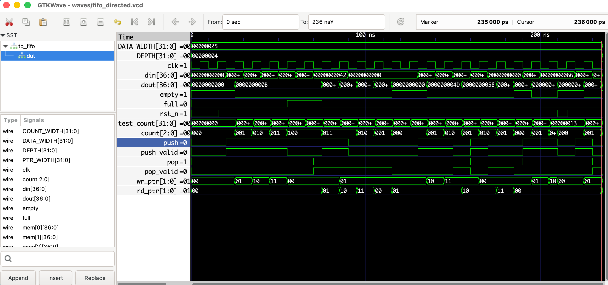

*Figure 1. Synchronous FIFO functional waveform.*

### FIFO Full Boundary

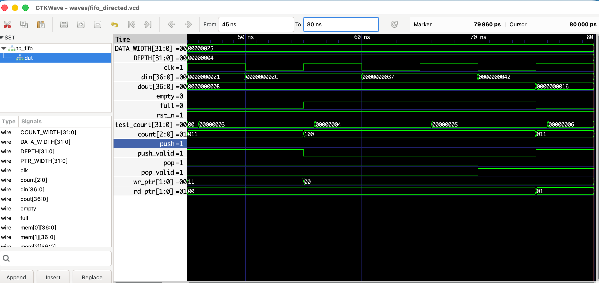

*Figure 2. FIFO full-condition verification.*

### FIFO Reset

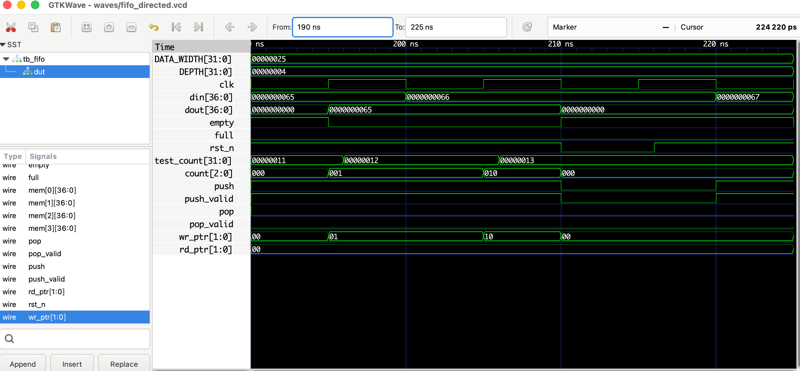

*Figure 3. FIFO reset behavior.*

### Simultaneous FIFO Push and Pop

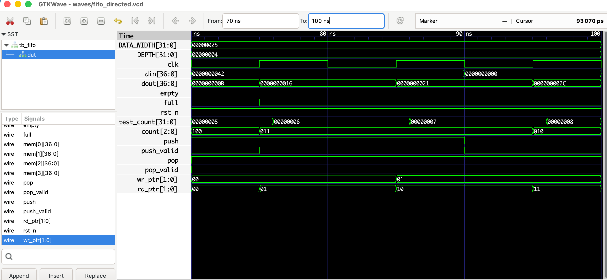

*Figure 4. FIFO operation with simultaneous push and pop.*

---

## 5.2 APB Register Verification

### APB Overall Simulation

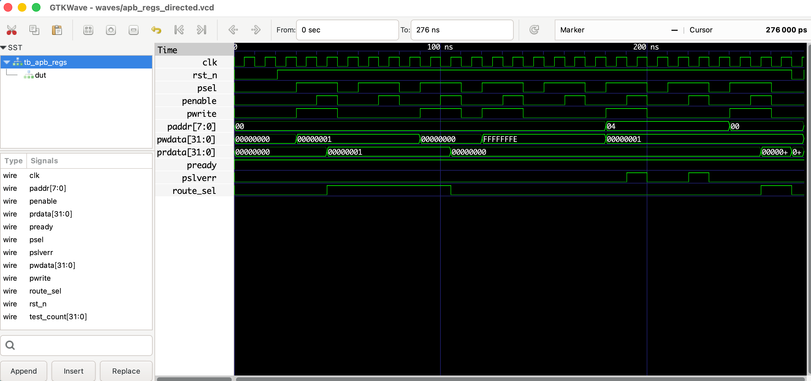

*Figure 5. APB register verification overview.*

### APB Read and Write Transfers

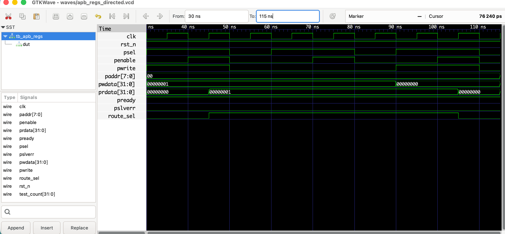

*Figure 6. APB register read/write transaction waveform.*

### Invalid APB Address Access

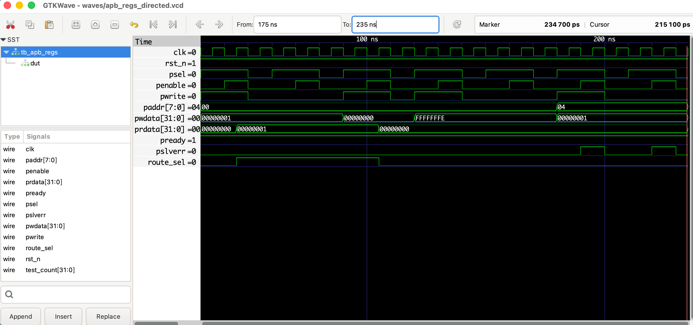

*Figure 7. Invalid APB address testing and error-response observation.*

Expected APB error responses are intentionally generated during negative testing and are distinct from UVM verification errors.

---

## 5.3 Integrated AXI-Stream Router Verification

### Router Functional Operation

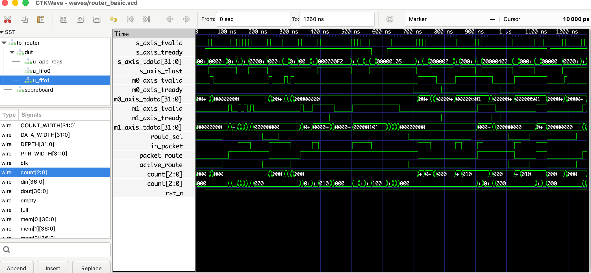

*Figure 8. Integrated AXI-Stream Router functional simulation.*

### Dual-Output FIFO Operation

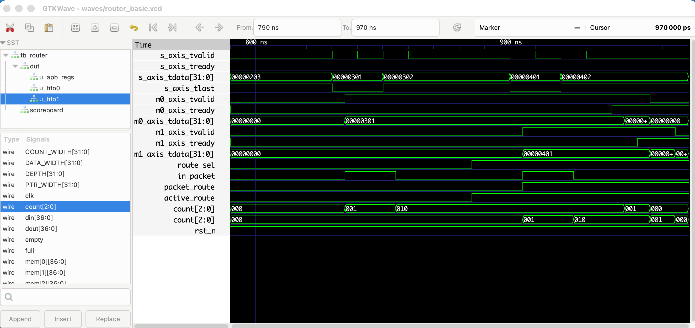

*Figure 9. Dual-output FIFO routing behavior.*

### Router FIFO Full and Backpressure

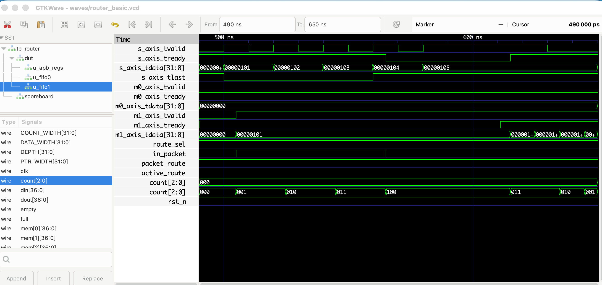

*Figure 10. Router FIFO-full boundary and backpressure test.*

### Packet-Level Route Locking

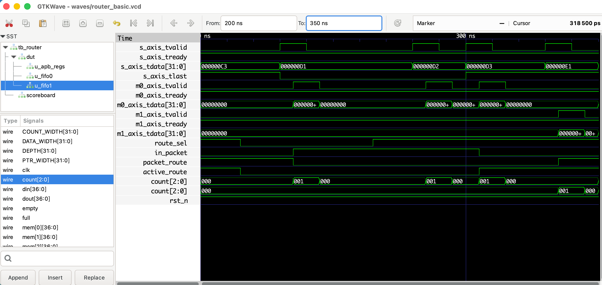

*Figure 11. Packet route-lock verification.*

### Router Reset Behavior

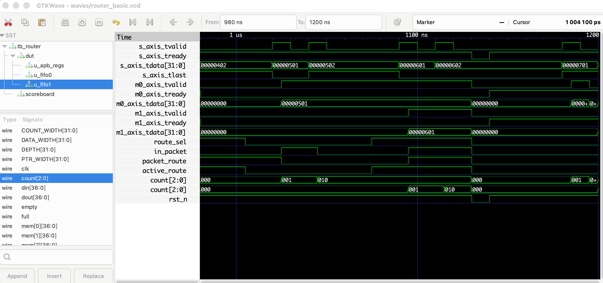

*Figure 12. Router reset verification.*

---

## 5.4 Advanced UVM Verification Evidence

In addition to the waveforms above, dedicated UVM scenarios verify combinations of behaviors that are difficult to establish from basic RTL unit tests alone.

| Scenario | Primary Verification Evidence |
|---|---|
| Dynamic APB Routing | `run_router_dynamic_uvm.sh` |
| FIFO Full + APB Route Change | `run_router_fifo_apb_uvm.sh` |
| Random Backpressure | `run_router_stress_uvm.sh` |
| Reset During Active Traffic | `run_router_reset_uvm.sh` |
| Sustained Backpressure | `run_router_long_stall_uvm.sh` |
| Parameterized FIFO Depth | `run_router_depth_uvm.sh` |
| Functional Coverage | `coverage_regression.md` |

**Note:** These scenario results are documented by executable tests and simulation logs. The gallery screenshots above represent the existing RTL waveform evidence; not every advanced UVM run has a separate screenshot.

---

# 6. Functional Coverage and Regression

## 6.1 Functional Coverage Model

The project defines 18 explicit transaction-level coverage bins.

| Coverage Dimension | Bins |
|---|---:|
| Packet route | 2 |
| Route × packet length | 6 |
| Route × final-beat TKEEP | 4 |
| Invalid APB access | 1 |
| Mid-packet APB route update | 1 |
| Source stall | 1 |
| Output 0 stall | 1 |
| Output 1 stall | 1 |
| Both outputs pending | 1 |
| **Total** | **18** |

Packet lengths are categorized as:

- Short: 1 beat
- Medium: 2–4 beats
- Long: 5 or more beats

Final-beat `TKEEP` is categorized as full or partial.

## 6.2 Multi-Seed Results

| Seed | Status | Coverage | AXI Beats | Packets | APB |
|---|---|---:|---:|---:|---:|
| 12345 | PASS | 18/18 (100.00%) | 143 | 33 | 51 |
| 2026 | PASS | 16/18 (88.89%) | 151 | 33 | 51 |
| 74018 | PASS | 16/18 (88.89%) | 139 | 33 | 51 |
| 314159 | PASS | 17/18 (94.44%) | 150 | 33 | 51 |
| 271828 | PASS | 18/18 (100.00%) | 152 | 33 | 51 |
| **Merged** | **5/5 PASS** | **18/18 (100.00%)** | **735** | **165** | **255** |

The merged coverage uses the union of bins hit by passing seeds, rather than an arithmetic average of individual coverage percentages.

## 6.3 Coverage Highlights

Selected aggregated hit counts:

| Functional Scenario | Total Hits |
|---|---:|
| Route 0 packets | 85 |
| Route 1 packets | 80 |
| Invalid APB accesses | 25 |
| Mid-packet APB route updates | 40 |
| Source stall cycles | 33 |
| Output 0 stall cycles | 326 |
| Output 1 stall cycles | 366 |
| Both outputs pending cycles | 17 |

**Merged coverage holes: 0 within the defined 18-bin model.**

### Coverage Reports

- [Full Coverage Regression Report](reports/coverage/coverage_regression.md)
- [Per-Seed Coverage CSV](reports/coverage/coverage_regression.csv)

### Coverage Limitations

This model uses explicit counters and UVM transaction observation.

It does not create a native SystemVerilog covergroup/UCIS database.

The project does not claim exhaustive RTL or formal verification.

---

# 7. Repository Structure

```text
AXI-Stream-Fusion-UVM/
|
+-- rtl/
|   +-- sync_fifo.sv
|   +-- apb_route_regs.sv
|   +-- buffered_router.sv
|
+-- tb/
|   +-- tb_fifo.sv
|   +-- tb_apb_regs.sv
|   +-- tb_router.sv
|   +-- uvm/
|       +-- axis_if.sv
|       +-- apb_if.sv
|       +-- axis_pkg.sv
|       +-- apb_pkg.sv
|       +-- axis_source_driver.svh
|       +-- axis_output_monitor.svh
|       +-- axis_router_scoreboard.svh
|       +-- apb_agent.svh
|       +-- router_dynamic_pkg.sv
|       +-- router_stress_pkg.sv
|       +-- router_coverage_pkg.sv
|       +-- router_reset_pkg.sv
|       +-- router_fifo_apb_pkg.sv
|       +-- router_long_stall_pkg.sv
|       +-- router_depth_pkg.sv
|       +-- tb_router_*_uvm_top.sv
|
+-- scripts/
|   +-- run_axis_driver_smoke.sh
|   +-- run_apb_uvm_smoke.sh
|   +-- run_router_dynamic_uvm.sh
|   +-- run_router_stress_uvm.sh
|   +-- run_router_regression.sh
|   +-- run_router_coverage_uvm.sh
|   +-- run_router_coverage_regression.sh
|   +-- run_router_reset_uvm.sh
|   +-- run_router_fifo_apb_uvm.sh
|   +-- run_router_long_stall_uvm.sh
|   +-- run_router_depth_uvm.sh
|   +-- aggregate_router_coverage.py
|
+-- docs/
|   +-- images/
|   |   +-- FIFO_complete_waveform.png
|   |   +-- FIFO_full.png
|   |   +-- FIFO_reset.png
|   |   +-- FIFO_simultaneously_push_pop.png
|   |   +-- APB_total.png
|   |   +-- APB_read_or_write.png
|   |   +-- APB_Invalid_Address.png
|   |   +-- Router_complete_figure.png
|   |   +-- Router_Dual_FIFO.png
|   |   +-- Router_FIFO_Full.png
|   |   +-- Router_Packet_Lock.png
|   |   +-- Router_Reset.png
|   +-- specification.md
|   +-- router_architecture.md
|   +-- testplan.md
|   +-- toolchain.md
|
+-- reports/
|   +-- coverage/
|       +-- coverage_regression.csv
|       +-- coverage_regression.md
|
+-- README.md
+-- .gitignore
```

Build outputs, generated VCD files, and third-party UVM sources are excluded from the committed repository.

---

# 8. Toolchain and Dependencies

| Tool | Version / Purpose |
|---|---|
| SystemVerilog | RTL and UVM implementation |
| UVM | 2020.3.2 |
| Verilator | 5.052 |
| Python 3 | Coverage aggregation |
| Bash | Test and regression automation |
| VS Code | Development |
| Git / GitHub | Version control |

## 8.1 UVM Library Requirement

The simulation scripts expect the UVM source tree at:

```text
external/uvm/
```

The directory is excluded from Git because it contains a third-party dependency.

To reproduce UVM tests on another machine, obtain the compatible UVM library source and place it at the expected location.

The build scripts compile the UVM package and DPI implementation with Verilator.

Refer to [Toolchain Documentation](docs/toolchain.md) for additional setup details.

## 8.2 Common Verilator Options

```text
--binary
--timing
--vpi
--timescale 1ns/1ps
-Wno-fatal
```

Some tests also enable tracing for VCD generation.

---

# 9. Reproducing Verification Results

Run the following commands from the project root after configuring the toolchain and UVM dependency.

## 9.1 Standalone RTL Verification

```bash
./scripts/run_apb.sh
./scripts/run_router.sh
```

## 9.2 UVM Integration

```bash
./scripts/run_axis_driver_smoke.sh
./scripts/run_apb_uvm_smoke.sh
./scripts/run_router_dynamic_uvm.sh
```

## 9.3 Random Stress and Regression

```bash
./scripts/run_router_stress_uvm.sh
./scripts/run_router_regression.sh
```

## 9.4 Functional Coverage

```bash
./scripts/run_router_coverage_uvm.sh
./scripts/run_router_coverage_regression.sh
```

The coverage aggregation produces:

```text
reports/coverage/coverage_regression.csv
reports/coverage/coverage_regression.md
```

## 9.5 Advanced Corner Cases

```bash
./scripts/run_router_reset_uvm.sh
./scripts/run_router_fifo_apb_uvm.sh
./scripts/run_router_long_stall_uvm.sh
./scripts/run_router_depth_uvm.sh
```

Parameterized FIFO regression independently compiles the DUT for FIFO depths 2, 4, and 8.

Most UVM scripts emit simulation logs and optional VCD waveforms.

---

# 10. Verification Insights

## 10.1 Packet-Level vs. Beat-Level Control

AXI-Stream transfers occur one beat at a time, while the output destination remains associated with the entire packet.

Correct verification must model these two levels independently.

## 10.2 Backpressure Protocol Stability

When `TVALID=1` and `TREADY=0`, the transmitting interface must retain `TVALID` and payload signals until acceptance.

Sustained-stall tests exercise this requirement over hundreds of consecutive clock edges.

## 10.3 APB Control/Data-Plane Interaction

APB configuration changes can occur independently of AXI traffic.

The router must preserve the current packet destination even when the register value changes before the packet ends.

## 10.4 Reset-Aware Scoreboarding

Reset can legitimately discard buffered, unconsumed data.

The verification environment records such transactions separately so that reset behavior is not confused with a missing-output defect.

## 10.5 Functional Coverage vs. Data Checking

The scoreboard answers:

**Did the DUT deliver the expected data to the expected destination?**

The coverage model answers:

**Which defined functional scenarios have been exercised?**

Both are required for a meaningful verification result.

## 10.6 Parameterized Verification

FIFO capacity checks adapt to the elaborated depth rather than assuming a hard-coded queue capacity.

Tests independently exercised configurations with 2, 4, and 8 entries.

---

# 11. Documentation and Evidence

| Artifact | Description |
|---|---|
| [Specification](docs/specification.md) | Functional requirements and interface behavior |
| [RTL Architecture](docs/router_architecture.md) | Hardware structure and routing implementation |
| [Verification Plan](docs/testplan.md) | Planned verification scenarios |
| [Toolchain Guide](docs/toolchain.md) | UVM and Verilator environment |
| [Coverage Report](reports/coverage/coverage_regression.md) | Five-seed merged functional coverage |
| [Coverage CSV](reports/coverage/coverage_regression.csv) | Machine-readable seed-level results |
| [Simulation Images](docs/images/) | Twelve RTL/APB/FIFO/Router simulation screenshots |

---

# 12. Future Extensions

Possible additional work:

- Native SV covergroups and UCIS reporting
- RTL statement, branch, and toggle coverage
- Additional reset timing corner cases
- Additional simultaneous FIFO operations
- Expanded functional cross coverage
- Non-power-of-two FIFO depth verification, subject to RTL support
- CI-based regression automation

These are outside the completed verification scope and are not included in the reported 18-bin coverage percentage.

---

## Final Project Summary

AXI-Stream Fusion demonstrates a complete incremental verification workflow:

**RTL Design → Directed Tests → UVM Environment → Reference Scoreboard → Random Stress → Multi-Seed Regression → Functional Coverage → Advanced Corner Cases → Parameterized Verification**

The core verification scenarios passed with no reported UVM errors or fatals, and the defined functional coverage model reached **18/18 merged bins** across five passing seeds.

The repository contains the RTL implementation, reusable testbench code, regression scripts, coverage reports, documentation, and simulation waveform evidence.
